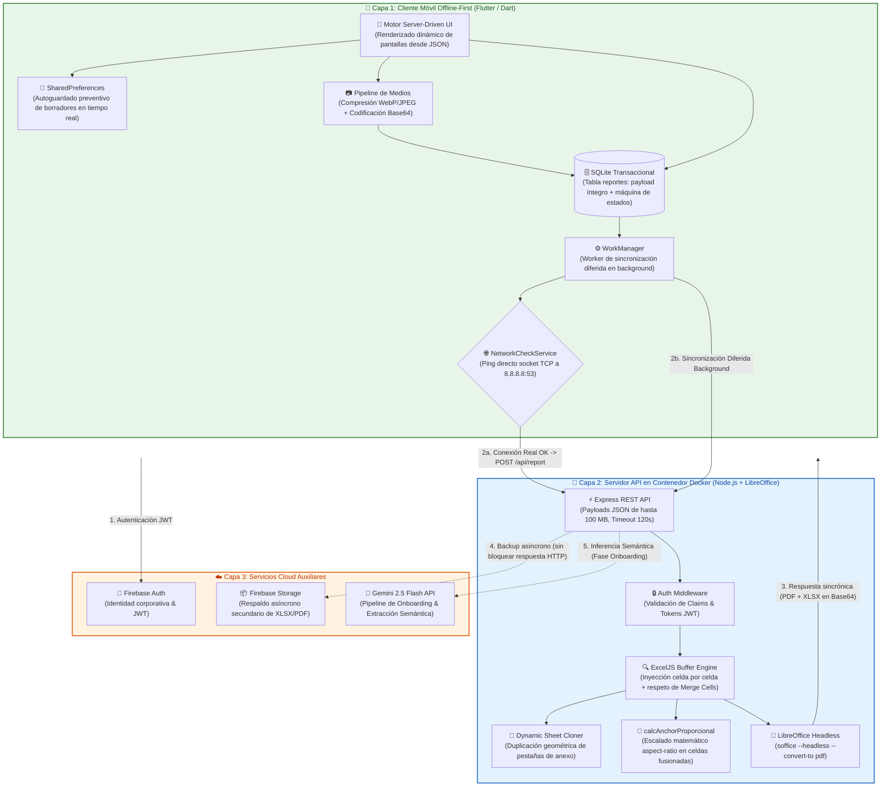
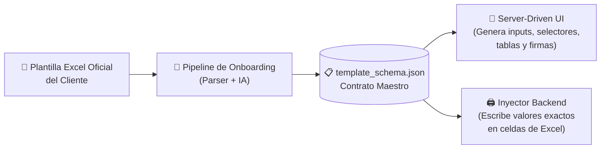
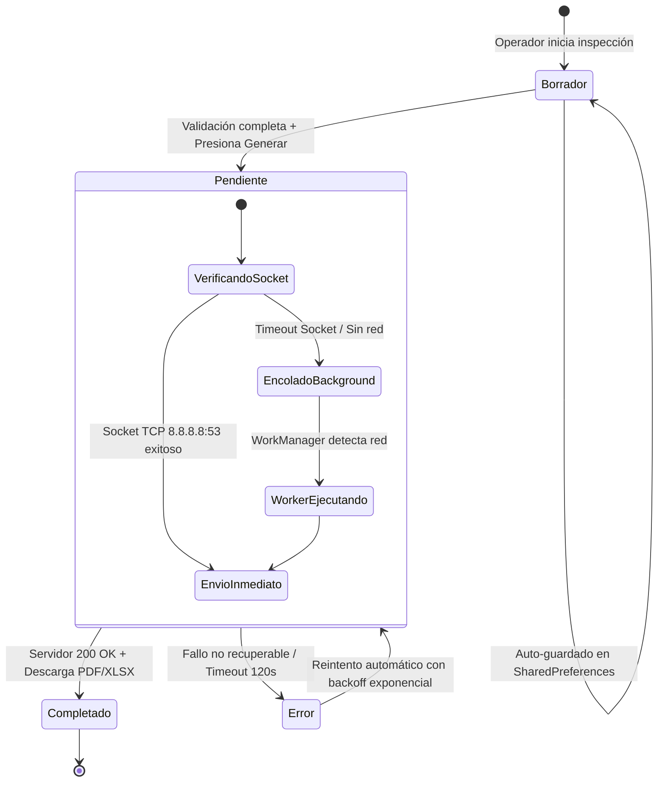
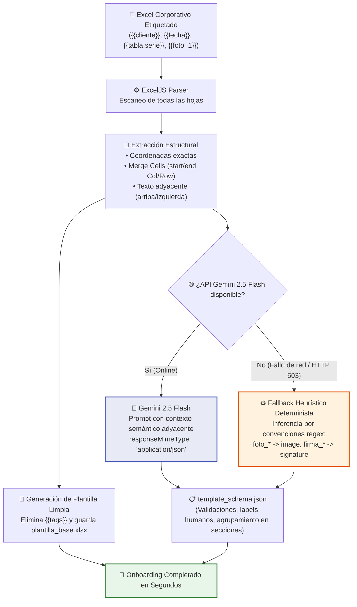

# 🏗️ SnapReport — Architecture & Engineering Showcase

<p align="center">
  <a href="https://www.snapreport.com.ar/">
    
  </a>
</p>

<p align="center">
  <strong>Plataforma B2B de Digitalización de Operaciones en Campo y Generación Automatizada de Reportes Corporativos con Fidelidad Visual 1:1</strong>
</p>

<p align="center">
  <a href="https://www.snapreport.com.ar/">🌐 www.snapreport.com.ar</a> • 
  <a href="#arquitectura-general-del-sistema-3-capas">Arquitectura</a> • 
  <a href="#los-4-pilares-de-ingenier%C3%ADa">Pilares de Ingeniería</a> • 
  <a href="#estructura-del-repositorio">Estructura</a> • 
  <a href="#stack-tecnol%C3%B3gico">Stack Tecnológico</a>
</p>

---

## 📌 Descripción Ejecutiva

**SnapReport** es una solución de software empresarial (B2B SaaS) diseñada para transformar la operativa de inspecciones, auditorías y certificaciones técnicas en industrias exigentes (energía, servicios petroleros, minería, manufactura pesada y mantenimiento de infraestructura).

### El Desafío de la Industria
Las corporaciones operan históricamente con **planillas Excel propietarias altamente complejas**, repletas de macros, fórmulas normativas, celdas combinadas (*Merge Cells*) y formatos visuales estrictos exigidos por sus clientes y entes regulatorios. La migración a formularios móviles tradicionales suele fracasar porque:
1. Los inspectores en campo trabajan habitualmente en **zonas remotas sin conectividad** (plantas subterráneas, yacimientos, alta mar).
2. Los sistemas convencionales exportan PDFs genéricos que destruyen el formato corporativo original, requiriendo doble carga manual en oficina.

### La Solución de Ingeniería de SnapReport
SnapReport cierra esta brecha mediante un **motor agnóstico guiado por especificaciones**:
- **Captura Offline-First:** Los técnicos registran mediciones, checklists dinámicos, evidencias fotográficas de alta resolución y firmas digitales sin requerir conexión a internet.
- **Inyección 1:1 sobre Plantillas Reales:** El backend no "dibuja" un PDF desde cero; inyecta los datos directamente sobre los buffers binarios del archivo `.xlsx` oficial del cliente, respetando milimétricamente fuentes, márgenes, celdas fusionadas y fórmulas.
- **Renderizado Headless:** Convierte el documento procesado a PDF corporativo mediante microservicios en contenedores Docker para entrega inmediata.

---

> [!NOTE]
> ### 🛡️ Nota sobre Propiedad Intelectual y Alcance del Repositorio
> Este repositorio público constituye un **Engineering Showcase** destinado a evaluar decisiones de arquitectura de software, modelado de datos, diseño de sistemas distribuidos y patrones de integración de IA.
> 
> El código fuente propietario de los módulos de producción (`servidor_api/` y `app_movil/`) permanece bajo **licencia comercial privada**. Todos los ejemplos, esquemas y capturas incluidos en este showcase utilizan datos industriales anonimizados y modelos genéricos.

---

## 🏛️ Arquitectura General del Sistema (3 Capas)

SnapReport implementa una arquitectura distribuida desacoplada en 3 capas, optimizada para resiliencia en red degradada y procesamiento documental de alto rendimiento:



---

## ⚙️ Los 4 Pilares de Ingeniería

### 1. Motor Dinámico Basado en Contratos JSON

En sistemas tradicionales, cada nueva plantilla de cliente requiere codificar nuevas pantallas móviles y controladores backend de renderizado. En SnapReport, **el sistema está 100% desacoplado mediante contratos declarativos**.



- **Server-Driven UI:** La aplicación móvil no conoce de antemano el formulario. Recibe el esquema JSON y construye dinámicamente secciones, campos simples, selectores, controles de firma sobre canvas y tablas repetibles.
- **Restricciones Geométricas Reales:** La app impone validaciones basadas en los límites físicos de la plantilla Excel (ej. `max_filas` en tablas repetibles para no romper encabezados inferiores).
- **Mapeo Bidireccional (`excel_map`):** Cada componente declara su hoja y coordenada (`F7`), o su rectángulo de celdas combinadas (`startCol`, `endCol`, `startRow`, `endRow`).

> 📄 **Contrato Maestro de Referencia:** Consulta el archivo [`schemas/template_schema_example.json`](schemas/template_schema_example.json) para ver una especificación completa de inspección industrial.

---

### 2. Ingeniería Offline-First y Persistencia Transaccional en SQLite

En campo no existe la conectividad garantizada. El sistema asume un entorno de **falla de red por defecto**.



- **Atomicidad Transaccional:** Se almacena el payload completo de la transacción (incluyendo fotos de evidencia y firmas en Base64) en una única celda `reporte_json` dentro de SQLite. Si la fila existe, el reporte está 100% íntegro; no existen archivos huérfanos ni estados intermedios inconsistentes.
- **Verificación Real de Red:** Las APIs del sistema operativo informan si la antena WiFi o 4G está encendida, pero no si existe salida a internet. SnapReport abre un socket TCP crudo a `8.8.8.8:53` con timeout de 3 segundos antes de disparar transferencias pesadas.
- **Autoguardado Preventivo:** Cada pulsación de tecla o captura fotográfica serializa el estado a `SharedPreferences` bajo `snapreport_draft`, permitiendo recuperación inmediata ante cortes de batería o cierres forzados.

> 📚 **Profundización Técnica:** Consulta el documento [`docs/01_DATA_MODEL_AND_OFFLINE_SYNC.md`](docs/01_DATA_MODEL_AND_OFFLINE_SYNC.md).

---

### 3. Pipeline de Onboarding con IA Generativa

Digitalizar una planilla industrial de 50 campos solía demandar entre 6 y 10 horas de mapeo manual celda por celda. SnapReport automatiza este flujo combinando parsing determinista con LLMs multimodales:



- **Inferencia Semántica por Adyacencia:** El parser extrae el texto de las celdas contiguas (arriba y a la izquierda). Si `F7` contiene `{{cliente}}` y `E7` dice *"Razón Social del Contratista:"*, el modelo asigna automáticamente esa etiqueta legible y el tipo de dato correspondiente.
- **Salida Estructurada Determinista:** Se utiliza `responseMimeType: "application/json"` con temperatura `0.1` en `gemini-2.5-flash` para garantizar una respuesta parseable y libre de alucinaciones.
- **Motor Heurístico de Contingencia:** Si la API externa se encuentra caída o sin conectividad, un motor de reglas basado en expresiones regulares resuelve el esquema de forma autónoma.

> 📚 **Profundización Técnica:** Consulta el documento [`docs/02_AI_ONBOARDING_AND_SPEC_DRIVEN_DEV.md`](docs/02_AI_ONBOARDING_AND_SPEC_DRIVEN_DEV.md).

---

### 4. Motor de Renderizado Documental en Memoria

El backend ejecuta un motor de generación de alta fidelidad que manipula buffers en memoria para evitar cuellos de botella de disco y garantizar concurrencia aislada:

#### a) Algoritmo de Escalado Proporcional (`calcAnchorProporcional`)
Las imágenes de campo y firmas nunca deben deformar su relación de aspecto (*aspect-ratio*), pero deben ocupar el espacio exacto de las celdas combinadas de la plantilla:

$$\text{escala} = \min\left(\frac{\text{anchoDisponible}}{\text{anchoImagen}}, \frac{\text{altoDisponible}}{\text{altoImagen}}\right)$$

$$\text{anchoFinal} = \text{anchoImagen} \times \text{escala}, \quad \text{altoFinal} = \text{altoImagen} \times \text{escala}$$

$$\text{offsetX} = \frac{\text{anchoDisponible} - \text{anchoFinal}}{2}, \quad \text{offsetY} = \frac{\text{altoDisponible} - \text{altoFinal}}{2}$$

Esto centra matemáticamente cada imagen o firma vectorial dentro del rectángulo de celdas combinadas en Excel.

#### b) Clonado Dinámico de Hojas de Anexo
Si una inspección requiere 18 fotografías pero la hoja de anexo de la plantilla posee únicamente 4 slots geométricos, el motor:
1. Detecta la regla `anexo_dinamico` en el esquema.
2. Clona la hoja molde (`anexo_1` $\rightarrow$ `anexo_2`, `anexo_3`, etc.) duplicando anchos de columna, altos de fila, celdas combinadas y el `PageSetup` (configuración de impresión A4, orientación y áreas de impresión).
3. Distribuye las imágenes secuencialmente en los slots correspondientes.

#### c) Conversión Headless a PDF
El buffer Excel final se convierte a PDF dentro del contenedor Docker mediante LibreOffice en modo headless:
```bash
soffice --headless --convert-to pdf --outdir /tmp /tmp/temp_report_<uuid>.xlsx
```
El contenedor incluye paquetes de fuentes TrueType (`fonts-liberation`, fuentes métricamente equivalentes a Arial/Calibri) para evitar alteraciones en el *bounding box* de página de los documentos industriales.

---

## 📁 Estructura del Repositorio

El contenido de este showcase se organiza de acuerdo a la siguiente estructura modular:

```
showcase_publico/
│
├── README.md                                          ← Portada principal, arquitectura y pilares (este documento)
│
├── schemas/
│   └── template_schema_example.json                   ← Contrato maestro JSON representativo (Inspección Técnica Industrial)
│
└── docs/
    ├── 01_DATA_MODEL_AND_OFFLINE_SYNC.md              ← Persistencia SQLite, máquina de estados y sincronización por sockets
    └── 02_AI_ONBOARDING_AND_SPEC_DRIVEN_DEV.md        ← Pipeline de IA generativa y Metodología Spec-Driven Development
```

---

## 🛠️ Stack Tecnológico

| Capa / Módulo | Tecnologías Seleccionadas | Racional de Arquitectura |
|---|---|---|
| **Motor Móvil** | Flutter (Dart 3.x), Canvas API | UI multiplataforma de 60 FPS, Server-Driven UI y captura de firmas en vector puro. |
| **Persistencia Local** | SQLite (`sqflite`), `SharedPreferences` | Transaccionalidad ACID local, almacenamiento íntegro de payloads y autoguardado rápido. |
| **Sincronización** | `WorkManager`, Raw TCP Sockets | Ejecución garantizada en background con validación estricta de red en `8.8.8.8:53`. |
| **Procesamiento de Medios** | `flutter_image_compress`, `image-size` | Reducción de peso de imágenes en origen manteniendo legibilidad técnica industrial. |
| **Backend Core** | Node.js (LTS), Express | I/O asíncrono no bloqueante capaz de gestionar payloads de hasta 100 MB. |
| **Motor de Planillas** | `ExcelJS` | Manipulación de libros Excel a nivel de celdas combinadas, estilos y buffers binarios. |
| **Conversor de Documentos** | LibreOffice Headless (`soffice`) | Renderizado de documentos PDF con fidelidad 1:1 respecto a la versión impresa de Excel. |
| **Contenedorización** | Docker, Alpine/Debian Slim | Empaquetamiento reproducible con dependencias de LibreOffice y fuentes tipográficas. |
| **Servicios Cloud** | Firebase Auth (JWT), Firebase Storage | Gestión segura de identidad y almacenamiento de réplicas en la nube sin acoplamiento. |
| **Inteligencia Artificial** | Gemini 2.5 Flash, Structured JSON | Análisis semántico rápido de celdas adyacentes con modo JSON determinista (`temp: 0.1`). |

---

## 👨‍💻 Perfil del Autor y Contacto

Este repositorio fue elaborado para ilustrar el enfoque de diseño de sistemas, modelado de datos y desarrollo guiado por especificaciones aplicado en un producto de software real de misión crítica.

* **Proyecto:** SnapReport — Plataforma de Reportes Industriales
* **Sitio Web Oficial:** [https://www.snapreport.com.ar/](https://www.snapreport.com.ar/)
* **Rol de Ingeniería:** Arquitecto de Software / Tech Lead / Analista Técnico de Sistemas

---

<p align="center">
  <sub>© SnapReport. Documentación de ingeniería y arquitectura publicada bajo fines demostrativos. Propiedad intelectual de código fuente reservada.</sub>
</p>
