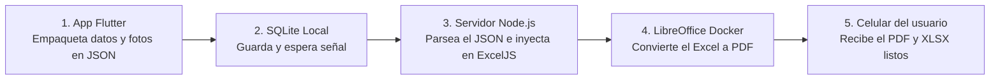

# SnapReport

<p align="center">
  <a href="https://www.snapreport.com.ar/">
  </a>
</p>

<p align="center">
  <strong>Sistema adaptable a medida para digitalizar la toma de datos y generar planillas de Excel y PDF de forma automática</strong>
</p>

<p align="center">
  <a href="https://www.snapreport.com.ar/">www.snapreport.com.ar</a>
</p>

---

## Sobre el proyecto

En Argentina, gran parte de las PyMEs, comercios y empresas de servicios siguen manejando su operativa diaria de forma manual. Lo más común es que el trabajador anote datos en un papel o mande fotos y textos sueltos por un grupo de WhatsApp, y que después alguien en la administración tenga que sentarse horas a pasar toda esa información a mano a una planilla de Excel.

**SnapReport** no está planteado como una aplicación enlatada de suscripción, sino como un **sistema base que se adapta a medida de cada empresa o negocio**. La idea central es eliminar ese paso intermedio administrativo: que el mismo empleado que está en el lugar de trabajo pueda cargar los datos, fotos y firmas en un formulario simple desde el celular, y que el sistema arme por detrás la planilla oficial de la empresa lista para usar o enviar.

Esto aplica tanto para trabajo en terreno como para negocios con carga diaria de planillas:
1. **Trabajo en la calle o en campo (con o sin señal):** Técnicos de mantenimiento, inspecciones industriales o cuadrillas que relevan datos y fotos en el lugar y necesitan que la planilla llegue armada a la oficina sin pasar todo por WhatsApp.
2. **Negocios que hacen muchas planillas repetitivas:** Empresas que llenan decenas de formularios iguales por día, como una agencia de alquiler de autos que tiene que hacer el check-in de cada vehículo con fotos y firma del cliente, o comercios que registran cierres y ventas diarias.

---

## Cómo funciona en el día a día (Línea de tiempo)

### 1. Cómo lo ve el usuario (En el celular)
* **Paso 1:** El trabajador abre la aplicación en su teléfono y elige la planilla con la que tiene que trabajar.
* **Paso 2:** Completa un formulario guiado paso a paso (textos, números, fechas, desplegables), saca las fotos necesarias desde la cámara y firma con el dedo en la pantalla.
* **Paso 3:** Mientras va escribiendo, la aplicación guarda un borrador automático en el teléfono por si se le apaga la pantalla o se cierra la app por accidente.
* **Paso 4:** Toca "Generar Reporte". Si no tiene internet en ese momento, el reporte queda guardado en el teléfono como *Pendiente* y se envía solo en segundo plano apenas recupera señal.
* **Paso 5:** En unos segundos recibe en su teléfono el archivo Excel (`.xlsx`) y el `.pdf` terminados, con el diseño exacto que usa la empresa, listos para abrir o compartir por WhatsApp.

### 2. Qué pasa por detrás (App + Servidor)
* **Paso 1 (Armado del formulario):** La app en Flutter no tiene pantallas fijas programadas para un cliente específico; lee un archivo de configuración (`template_schema.json`) y dibuja en el momento los casilleros, tablas y botones que pide esa planilla.
* **Paso 2 (Empaquetado local):** Al enviar el formulario, la app comprime las fotos (`flutter_image_compress`) para que pesen pocos kilobytes y las convierte junto con las firmas a texto en formato `Base64`.
* **Paso 3 (Control de conexión y SQLite):** Todo el paquete de datos se guarda como un único `.json` en una base de datos local `SQLite`. Antes de enviarlo, la app verifica si hay salida real a internet abriendo un socket TCP (`8.8.8.8:53`). Si no hay red, `WorkManager` queda a la espera para mandarlo después.
* **Paso 4 (Parseo e inyección en el Servidor):** El servidor en `Node.js` (Express) recibe el `.json` mediante un `POST /api/report`, lo parsea, clona en memoria el archivo Excel original de la empresa (`plantilla_base.xlsx`) y usa `ExcelJS` para escribir cada dato en su coordenada exacta.
* **Paso 5 (Escalado de fotos y Anexos):** Para las fotos y firmas, el servidor lee las dimensiones con `image-size`, calcula el tamaño en píxeles de las celdas combinadas (*Merge Cells*) y escala la imagen manteniendo su proporción para que quede centrada y no se deforme. Si mandan más fotos de las que entran en una hoja de anexo, clona la pestaña dinámicamente (`anexo_1` -> `anexo_2`).
* **Paso 6 (Conversión a PDF y respuesta):** Dentro del contenedor `Docker`, el servidor ejecuta `LibreOffice Headless` por consola para convertir ese Excel a PDF respetando los márgenes de impresión A4, devuelve ambos archivos en `Base64` al celular y guarda una copia de respaldo en `Firebase Storage`.



---

## Cómo el sistema entiende cualquier planilla X y se adapta solo

Para no tener que programar pantallas nuevas en Flutter ni escribir coordenadas a mano en el servidor cada vez que una empresa trae una planilla distinta, el backend tiene un analizador de plantillas (`templateAnalyzer.js`).

```mermaid
flowchart LR
    A[Planilla Excel X<br/>con etiquetas {{...}}] --> B[Analizador Node.js<br/>ExcelJS + Gemini API]
    B --> C[plantilla_base.xlsx<br/>Limpia sin etiquetas]
    B --> D[template_schema.json<br/>Mapa de cada casillero]
```

El proceso para adaptar el sistema a la planilla de cualquier empresa funciona en 4 pasos:

1. **Etiquetado rápido en el Excel original:**
   Se toma el archivo `.xlsx` que ya usa la empresa y en los casilleros vacíos donde tienen que ir los datos se escriben etiquetas entre llaves, por ejemplo: `{{cliente}}`, `{{fecha}}`, `{{firma_encargado}}` o `{{foto_1}}`. Si hay una tabla donde se cargan varios renglones (como una lista de ítems, repuestos o ventas), solo se etiqueta la primera fila vacía con el formato `{{tabla.columna}}`.

2. **Escaneo del Excel y detección de casilleros (`ExcelJS`):**
   Se sube ese Excel al endpoint `POST /api/templates/analyze`. El servidor recorre todas las hojas buscando los `{{...}}` y registra:
   * En qué hoja y coordenada exacta está cada etiqueta (ej. `C6` o `BL4`).
   * Si la etiqueta está adentro de un bloque de celdas combinadas (*Merge Cells*), guardando desde qué fila y columna empieza hasta dónde termina (`startCol`, `endCol`, `startRow`, `endRow`).
   * Para las tablas repetibles, cuenta automáticamente cuántas filas vacías tiene dibujadas la planilla hacia abajo antes de chocar con otra sección, definiendo así el tope (`max_filas`) para que el usuario nunca pise el resto del documento.
   * Lee qué texto hay escrito en las celdas vecinas (arriba y a la izquierda) para saber qué pide ese casillero.

3. **Limpieza automática de la planilla:**
   Una vez que anotó todas las posiciones, el mismo script borra las etiquetas `{{...}}` de las celdas para que el Excel vuelva a quedar vacío con su diseño original intacto, y lo guarda en el servidor como `plantilla_base.xlsx`.

4. **Armado del `.json` que guía a todo el sistema:**
   Con la lista de etiquetas y el texto vecino de cada celda, el servidor consulta a la API de Gemini (`gemini-2.5-flash` configurada para devolver JSON, o usando un motor de reglas propio si no hay conexión) para definir qué tipo de dato va en cada casillero (`text`, `number`, `date`, `select`, `image`, `signature`) y ponerle un nombre claro para el usuario. Todo ese mapa se guarda en `template_schema.json`.

Con ese `.json` creado, tanto la aplicación móvil como el servidor ya saben qué formulario mostrar en pantalla y en qué casillero exacto del Excel meter cada respuesta.

---

## Estructura del Repositorio

```text
showcase_publico/
│
├── README.md                                        <- Descripción general y funcionamiento del sistema
│
├── schemas/
│   └── template_schema_example.json                 <- Ejemplo real del archivo JSON generado para una planilla
│
└── docs/
    ├── 01_DATA_MODEL_AND_OFFLINE_SYNC.md            <- Detalle de la base SQLite, estados y modo offline
    └── 02_AI_ONBOARDING_AND_SPEC_DRIVEN_DEV.md      <- Detalle del analizador de plantillas y uso de IA
```

---

## Stack Técnico

* **Aplicación Móvil:** Flutter (Dart), `sqflite` (base de datos local SQLite), `shared_preferences` (autoguardado de borradores en tiempo real), `workmanager` (cola de sincronización en segundo plano), `flutter_image_compress`.
* **Servidor Backend:** Node.js con Express, `ExcelJS` (lectura de plantillas e inyección sobre buffers en memoria), `image-size` (lectura de dimensiones para escalado proporcional de fotos y firmas).
* **Conversión e Infraestructura:** Contenedor Docker (Linux) con LibreOffice Headless (`soffice --headless --convert-to pdf`) y fuentes tipográficas compatibles con Arial/Calibri.
* **Servicios Auxiliares:** API de Gemini 2.5 Flash (para armar el `.json` al cargar una plantilla nueva) y Firebase (Auth y Storage para respaldo en segundo plano).

---

## Contacto

* **Web:** [https://www.snapreport.com.ar/](https://www.snapreport.com.ar/)
