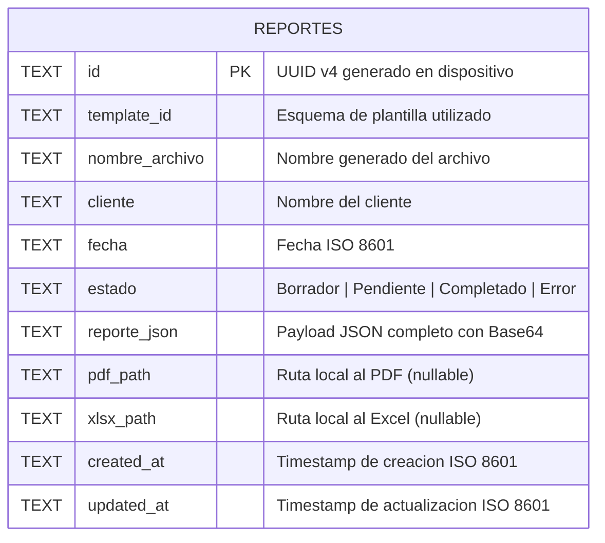
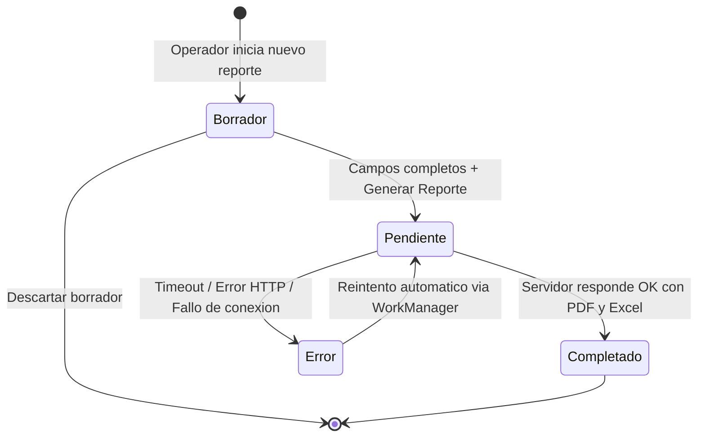
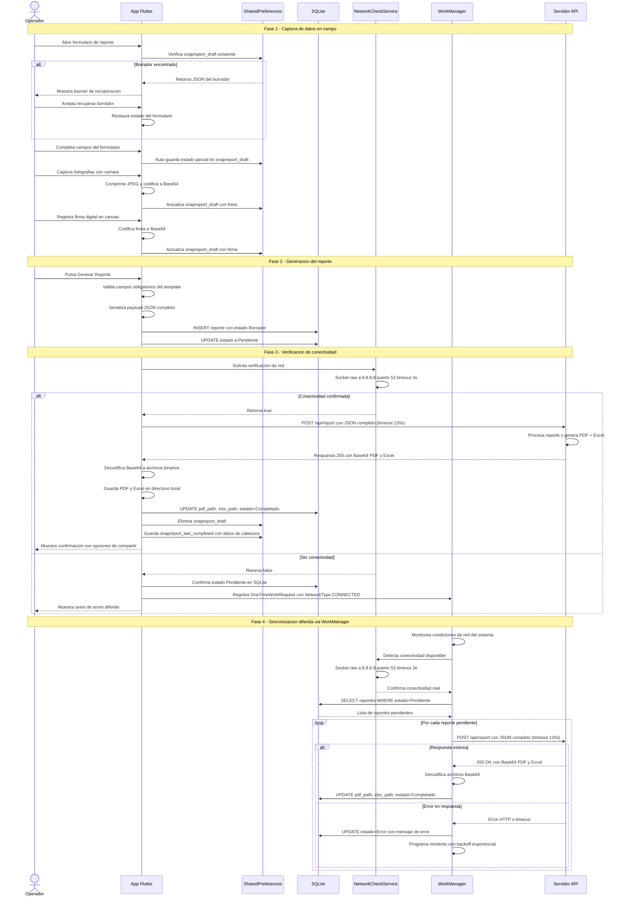

# Modelo de Datos y Sincronización Offline-First

> [!IMPORTANT]
> Este documento describe la arquitectura de persistencia local y el flujo de sincronización offline-first de **SnapReport**, diseñado para garantizar la integridad total de los datos en entornos de campo donde la conectividad es intermitente o inexistente.

---

## 1. Modelo Relacional en SQLite

SnapReport utiliza una base de datos **SQLite** local como fuente de verdad única en el dispositivo. El esquema se centra en una tabla principal `reportes` que encapsula toda la información necesaria para reconstruir, enviar y consultar cualquier reporte generado por un operador de campo.

### Estructura de la tabla `reportes`

| Columna | Tipo | Restricción | Descripción |
|---|---|---|---|
| `id` | `TEXT` | `PRIMARY KEY` | Identificador único universal (UUID v4) generado en el dispositivo al momento de crear el reporte. Garantiza unicidad sin necesidad de coordinación con el servidor. |
| `template_id` | `TEXT` | `NOT NULL` | Referencia al esquema de plantilla utilizado para generar el reporte. Permite determinar qué campos, secciones y reglas de validación se aplicaron durante la captura. |
| `nombre_archivo` | `TEXT` | `NOT NULL` | Nombre de archivo generado automáticamente siguiendo la convención `CLIENTE_TEMPLATE_YYYYMMDD_HHmmss`. Se utiliza para nombrar los archivos PDF y Excel resultantes. |
| `cliente` | `TEXT` | `NOT NULL` | Nombre del cliente asociado al reporte. Se emplea como filtro rápido en las vistas de listado e historial, permitiendo al operador localizar reportes anteriores sin necesidad de búsqueda avanzada. |
| `fecha` | `TEXT` | `NOT NULL` | Fecha del reporte en formato ISO 8601 (`YYYY-MM-DD`). Corresponde a la fecha de la inspección o servicio, no necesariamente a la fecha de creación del registro. |
| `estado` | `TEXT` | `NOT NULL DEFAULT 'Borrador'` | Valor de la máquina de estados que gobierna el ciclo de vida del reporte. Valores posibles: `Borrador`, `Pendiente`, `Completado`, `Error`. |
| `reporte_json` | `TEXT` | `NOT NULL` | Payload JSON completo de la transacción, incluyendo todos los campos del formulario, la firma digital y las fotografías codificadas en Base64. |
| `pdf_path` | `TEXT` | `NULLABLE` | Ruta local al archivo PDF generado tras la respuesta exitosa del servidor. Es `NULL` mientras el reporte no haya sido procesado. |
| `xlsx_path` | `TEXT` | `NULLABLE` | Ruta local al archivo Excel generado tras la respuesta exitosa del servidor. Es `NULL` mientras el reporte no haya sido procesado. |
| `created_at` | `TEXT` | `NOT NULL` | Marca temporal de creación del registro en formato ISO 8601 con zona horaria (`YYYY-MM-DDTHH:mm:ss.sssZ`). Se establece una única vez al insertar la fila. |
| `updated_at` | `TEXT` | `NOT NULL` | Marca temporal de la última modificación del registro. Se actualiza automáticamente en cada operación de escritura sobre la fila. |

### Diagrama Entidad-Relación



### Justificación del Payload JSON Monolítico con Imágenes Base64

La decisión de almacenar el JSON completo —incluyendo las fotografías codificadas en Base64— dentro de una única columna `reporte_json` responde a un principio fundamental de **atomicidad transaccional en entornos sin conectividad**.

En un esquema normalizado convencional, las imágenes se almacenarían como archivos independientes en el sistema de archivos, con referencias (rutas o URIs) dentro del JSON. Este enfoque, aunque eficiente en almacenamiento, introduce un riesgo crítico en operaciones de campo:

1. **Integridad garantizada por existencia de fila.** Si la fila existe en SQLite, el reporte completo existe. No hay posibilidad de referencias huérfanas a archivos de imagen que fueron eliminados por el sistema operativo (limpieza de caché), por el usuario (gestión de almacenamiento) o por una escritura parcial interrumpida.

2. **Transaccionalidad nativa de SQLite.** Una operación `INSERT` o `UPDATE` en SQLite es atómica por diseño. O se escribe toda la fila completa, o no se escribe nada. Esto elimina el escenario donde el JSON se guarda correctamente pero una o más fotos quedan sin persistir debido a una interrupción (batería agotada, cierre forzado de la aplicación, reinicio del dispositivo).

3. **Simplicidad en el reenvío.** Cuando WorkManager detecta conectividad y necesita enviar un reporte pendiente, basta con leer una única columna para obtener el payload completo listo para el `POST`. No se requiere reensamblar datos desde múltiples fuentes ni verificar la existencia de archivos externos.

4. **Portabilidad del respaldo.** La base de datos SQLite es un archivo único y autónomo. Copiar o respaldar este archivo garantiza que toda la información, incluyendo las evidencias fotográficas, viaja de forma íntegra.

> [!NOTE]
> El tamaño típico de un reporte con 5-10 fotografías comprimidas en JPEG de calidad media oscila entre 2 MB y 8 MB en Base64. SQLite maneja eficientemente blobs de este tamaño. El límite práctico por fila en SQLite es de 1 GB, muy por encima de los volúmenes operativos de SnapReport.

---

## 2. Máquina de Estados del Reporte

Cada reporte en SnapReport atraviesa un ciclo de vida gobernado por una máquina de estados finita con cuatro estados posibles y transiciones claramente definidas. Este modelo garantiza que el sistema siempre conoce la situación exacta de cada reporte y puede actuar en consecuencia de forma automática.

### Definición de Estados

| Estado | Descripción | Acción del Usuario | Acción del Sistema |
|---|---|---|---|
| **Borrador** | El operador está capturando datos. El formulario puede estar incompleto. El reporte aún no se ha enviado ni procesado. | Puede editar, completar campos o descartar el reporte. | Auto-guarda el borrador en SharedPreferences periódicamente. |
| **Pendiente** | Todos los campos requeridos están completos. El reporte ha sido enviado al servidor o está encolado para envío cuando haya conectividad. | Puede visualizar el reporte pero no editarlo. | Si hay red, envía inmediatamente. Si no, registra una tarea en WorkManager. |
| **Completado** | El servidor procesó exitosamente el reporte y devolvió los archivos PDF y Excel. Los archivos están almacenados localmente. | Puede visualizar, compartir o reenviar el PDF/Excel generado. | Limpia borradores temporales y archivos de caché asociados. |
| **Error** | El envío o procesamiento falló. El servidor retornó un código de error o la solicitud superó el tiempo límite de espera. | Puede visualizar el detalle del error. Puede forzar un reintento manual. | Programa un reintento automático mediante WorkManager con back-off exponencial. |

### Transiciones

- **Borrador → Pendiente:** El operador completa todos los campos obligatorios definidos por la plantilla y pulsa el botón «Generar Reporte». La aplicación valida la integridad del formulario, serializa el payload JSON completo (incluyendo imágenes y firma en Base64) y actualiza el estado a `Pendiente`.

- **Pendiente → Completado:** El servidor API recibe el payload, genera los documentos PDF y Excel, y responde con ambos archivos codificados en Base64. La aplicación decodifica los archivos, los almacena en el directorio de documentos del dispositivo y actualiza las columnas `pdf_path`, `xlsx_path` y `estado` en una única transacción SQLite.

- **Pendiente → Error:** La solicitud HTTP falla por cualquiera de las siguientes razones: timeout de 120 segundos alcanzado, código de respuesta HTTP 4xx/5xx, error de conexión durante la transmisión, o respuesta con formato inválido. El estado se actualiza a `Error` y se almacena el mensaje de error para diagnóstico.

- **Error → Pendiente:** WorkManager ejecuta un reintento automático cuando detecta conectividad de red disponible. El estado regresa a `Pendiente` y se realiza un nuevo intento de envío. Se aplica una estrategia de back-off exponencial para evitar sobrecargar el servidor en caso de fallos persistentes.

- **Borrador → (Descartado):** El operador puede eliminar explícitamente un borrador. Esta acción elimina la fila de SQLite, limpia el borrador de SharedPreferences y elimina los archivos temporales de fotografías asociados. Esta transición es terminal e irreversible.

### Diagrama de Estados



---

## 3. Flujo Completo de Sincronización Offline

El flujo de sincronización offline-first de SnapReport está diseñado para que el operador de campo pueda completar su trabajo sin ninguna dependencia de la red. La generación de documentos se delega al servidor, pero la captura, persistencia y encolamiento de datos son completamente locales.

### Diagrama de Secuencia



### Descripción Detallada de Cada Fase

**Fase 1 — Captura de datos en campo.** El operador abre el formulario correspondiente a la plantilla seleccionada. La aplicación verifica inmediatamente la existencia de un borrador previo en SharedPreferences. Si existe, se ofrece un banner de recuperación que permite restaurar el progreso anterior. Durante la captura, cada cambio en el formulario dispara un auto-guardado que serializa el estado completo del formulario (incluyendo fotografías ya codificadas) en SharedPreferences bajo la clave `snapreport_draft`.

**Fase 2 — Generación del reporte.** Al pulsar «Generar Reporte», la aplicación ejecuta las validaciones definidas por el esquema de la plantilla. Si todos los campos obligatorios están completos, serializa el payload JSON final y lo persiste en SQLite mediante una inserción atómica. El estado se actualiza a `Pendiente`, señalizando que el reporte está listo para ser procesado por el servidor.

**Fase 3 — Verificación de conectividad y envío.** Antes de intentar el envío, `NetworkCheckService` ejecuta una verificación real de conectividad mediante un socket TCP directo al puerto 53 de `8.8.8.8` con un timeout de 3 segundos. Si la verificación es exitosa, se ejecuta el `POST` inmediato con un timeout de 120 segundos. Si no hay conectividad, el reporte permanece en SQLite con estado `Pendiente` y se registra una tarea en WorkManager.

**Fase 4 — Sincronización diferida.** WorkManager monitorea las condiciones de red del sistema operativo. Cuando detecta que una conexión de red está disponible, ejecuta la tarea registrada. Antes de enviar, realiza su propia verificación de conectividad real para evitar falsos positivos de la API de conectividad del sistema. Procesa cada reporte pendiente de forma secuencial, actualizando el estado en SQLite tras cada operación.

---

## 4. Verificación Real de Conectividad

### El Problema con las APIs Estándar de Conectividad

Las APIs de conectividad proporcionadas por los sistemas operativos móviles (tanto `ConnectivityManager` en Android como `Connectivity` en Flutter) se limitan a informar si el dispositivo tiene una **interfaz de red activa** (WiFi conectado, datos móviles habilitados). Sin embargo, tener una interfaz de red activa **no garantiza acceso real a Internet**. Los siguientes escenarios ilustran este problema:

| Escenario | Interfaz de Red | Internet Real | API del SO Reporta |
|---|---|---|---|
| **Portal cautivo** (WiFi de hotel, aeropuerto, cafetería) | WiFi conectado | No disponible hasta autenticación web | "Conectado" |
| **Red corporativa restringida** | WiFi conectado | Bloqueado por firewall/proxy | "Conectado" |
| **Datos móviles con cuota agotada** | Datos móviles activos | Sin tráfico permitido por el operador | "Conectado" |
| **Zona con señal débil** | Datos móviles activos | Paquetes descartados, latencia extrema | "Conectado" |
| **Modo avión** | Ninguna | No disponible | "Desconectado" |

En cuatro de los cinco escenarios, confiar en la API del sistema operativo habría resultado en un intento de envío fallido, degradando la experiencia del operador y consumiendo batería innecesariamente.

### La Solución: Socket TCP Directo

SnapReport implementa `NetworkCheckService`, un servicio que realiza una verificación de conectividad mediante un **socket TCP directo** al servidor DNS público de Google (`8.8.8.8`) en el puerto `53`:

```
Socket → 8.8.8.8:53 → Timeout: 3 segundos → Resultado: bool
```

**¿Por qué `8.8.8.8:53`?**

- **Alta disponibilidad.** El servicio DNS público de Google tiene un SLA de disponibilidad superior al 99.99%. Es uno de los servicios más confiables de Internet.
- **Puerto 53 (DNS).** Rara vez es bloqueado por firewalls corporativos o de operadores móviles, a diferencia de puertos HTTP comunes que pueden ser interceptados por proxies.
- **Respuesta rápida.** Un socket TCP solo necesita completar el handshake de tres vías (SYN → SYN-ACK → ACK) para confirmar conectividad. No se transfieren datos de aplicación.
- **Sin dependencia de HTTP.** No se realiza una solicitud HTTP, por lo que no se ve afectado por portales cautivos que redirigen solicitudes HTTP a páginas de autenticación.

**¿Por qué un timeout de 3 segundos?**

- En una conexión móvil funcional, el handshake TCP se completa en menos de 300 milisegundos.
- Un timeout de 3 segundos proporciona margen suficiente para conexiones lentas pero funcionales.
- Superar los 3 segundos indica una conexión tan degradada que el envío de un payload de varios megabytes sería impracticable de todas formas.

> [!TIP]
> El resultado de `NetworkCheckService` es un **booleano definitivo**: `true` significa que existe una ruta funcional de extremo a extremo hacia Internet; `false` significa que no se puede confiar en la red para transmitir datos. Esta simplicidad elimina la ambigüedad y simplifica toda la lógica de decisión del flujo de sincronización.

---

## 5. Estrategia de Autoguardado Preventivo

El sistema de autoguardado preventivo de SnapReport utiliza **SharedPreferences** como capa de persistencia ligera y rápida para proteger el trabajo en progreso del operador de campo contra cierres inesperados de la aplicación, agotamiento de batería o reinicios del dispositivo.

### Mecanismo de Autoguardado

En cada cambio de entrada del formulario (texto ingresado, fotografía capturada, firma registrada, opción seleccionada), la aplicación serializa el estado completo del formulario a JSON y lo almacena en SharedPreferences bajo la clave `snapreport_draft`:

```
snapreport_draft → {
    "template_id": "inspeccion_general_v2",
    "cliente": "Nombre del cliente",
    "fecha": "2025-03-15",
    "campos": { ... todos los valores del formulario ... },
    "fotos": [ ... cadenas Base64 de fotografías ... ],
    "firma": "data:image/png;base64,...",
    "timestamp_guardado": "2025-03-15T14:32:10.000Z"
}
```

Este mecanismo opera de forma transparente para el operador; no requiere ninguna acción manual de guardado. La serialización se ejecuta de forma asíncrona para no bloquear la interfaz de usuario.

### Recuperación de Borradores

Al abrir la aplicación o navegar al formulario de captura, la aplicación ejecuta la siguiente secuencia de verificación:

1. **Lectura de `snapreport_draft`:** Si existe un valor almacenado bajo esta clave, significa que una sesión de captura anterior no finalizó correctamente (el operador no completó el envío ni descartó el borrador de forma explícita).

2. **Presentación del banner de recuperación:** La aplicación muestra un banner no intrusivo en la parte superior de la pantalla informando al operador que se encontró un borrador sin completar. El banner incluye la fecha y hora del último guardado y el nombre del cliente asociado, permitiendo al operador identificar rápidamente el contexto del borrador.

3. **Decisión del operador:** El operador puede aceptar la recuperación (se restaura el estado completo del formulario) o descartarla (se elimina el borrador y se inicia un formulario vacío).

### Reutilización de Datos de Cabecera

Adicionalmente, la aplicación mantiene una segunda clave en SharedPreferences: `snapreport_last_completed`. Esta clave almacena únicamente los **datos de cabecera** del último reporte completado exitosamente:

```
snapreport_last_completed → {
    "cliente": "Nombre del cliente",
    "template_id": "inspeccion_general_v2",
    "campos_cabecera": {
        "ubicacion": "Planta Norte - Sector 4",
        "responsable": "Juan Pérez",
        "turno": "Matutino"
    }
}
```

Cuando el operador inicia un nuevo reporte, la aplicación detecta la existencia de esta clave y ofrece prellenar los campos de cabecera con los valores del reporte anterior. Este comportamiento es especialmente útil cuando el operador realiza múltiples inspecciones consecutivas en la misma ubicación o para el mismo cliente, reduciendo significativamente el tiempo de captura.

### Limpieza de Recursos Temporales

La limpieza de borradores y archivos temporales se ejecuta en dos escenarios:

| Escenario | Acciones de Limpieza |
|---|---|
| **Reporte completado exitosamente** | Se elimina `snapreport_draft` de SharedPreferences. Se actualizan los datos en `snapreport_last_completed` con la cabecera del reporte recién completado. Se eliminan los archivos temporales de fotografías del directorio de caché de la aplicación (las versiones definitivas ya están codificadas en Base64 dentro del payload persistido en SQLite). |
| **Descarte explícito del borrador** | Se elimina `snapreport_draft` de SharedPreferences. Se elimina la fila correspondiente de SQLite (si ya se había insertado). Se eliminan los archivos temporales de fotografías del directorio de caché. No se modifica `snapreport_last_completed`, preservando los datos de cabecera del último reporte completado para futura reutilización. |

> [!WARNING]
> Los archivos temporales de fotografías almacenados en el directorio de caché de la aplicación son vulnerables a eliminación por el sistema operativo cuando el dispositivo tiene poco espacio de almacenamiento. Por esta razón, las fotografías se codifican en Base64 y se incorporan al JSON del borrador en SharedPreferences tan pronto como son capturadas, garantizando una segunda copia independiente del sistema de archivos.

---

> [!NOTE]
> Esta arquitectura ha sido diseñada y validada para operar en condiciones reales de campo donde la conectividad es impredecible. El principio rector es que **ningún dato capturado por el operador debe perderse**, independientemente del estado de la red, la batería o la aplicación.
