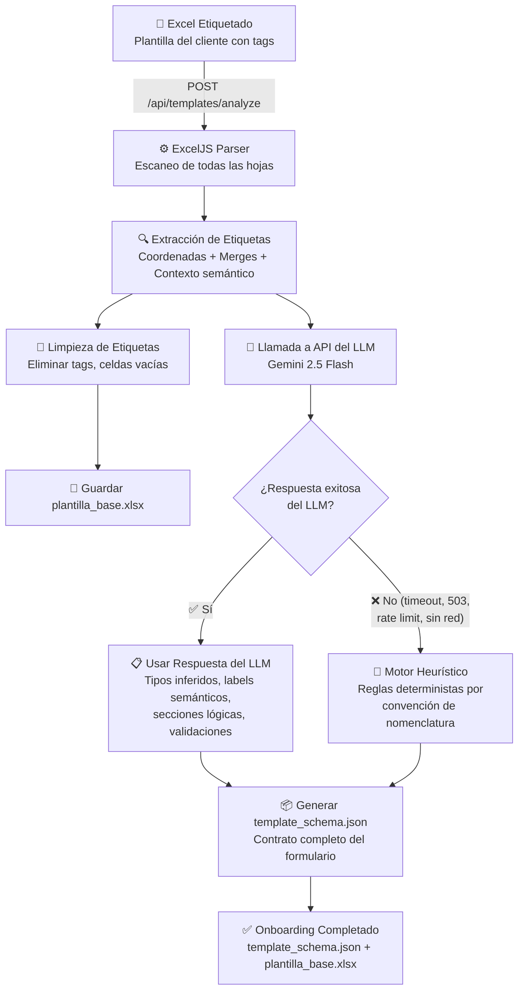
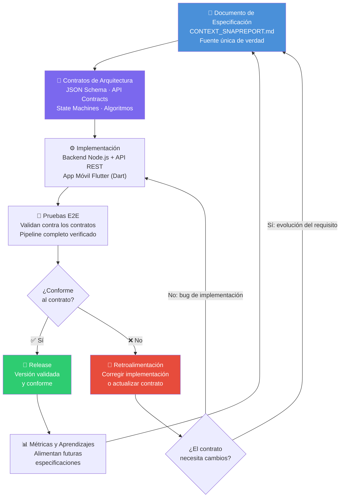

# Pipeline de Onboarding con IA Generativa y Desarrollo Guiado por Especificaciones

> [!NOTE]
> Este documento describe dos pilares fundamentales de SnapReport: la automatización del onboarding de clientes industriales mediante inteligencia artificial generativa y la metodología de desarrollo guiado por especificaciones (Spec-Driven Development) que garantiza la coherencia entre contratos de datos, implementación y pruebas.

---

## Parte A: IA Integrada en el Producto

### 1. Problema de Negocio

En el sector de inspecciones industriales, cada cliente opera con su propia plantilla Excel propietaria. Estas plantillas varían enormemente en estructura: distintas hojas, celdas combinadas con rangos irregulares, secciones con nomenclaturas específicas del rubro, campos de texto libre intercalados con tablas de datos numéricos, espacios reservados para fotografías y firmas, y formatos de fecha particulares según la normativa de cada organización.

Construir manualmente el contrato JSON que mapea cada celda, cada rango de combinación, cada sección y cada tipo de campo representa un proceso tedioso que puede consumir varias horas de trabajo especializado por cada plantilla. Además, este proceso manual es propenso a errores: una coordenada mal transcrita, un rango de merge omitido o un tipo de campo incorrecto pueden provocar que el reporte generado sea inválido o que los datos aparezcan en las celdas equivocadas del Excel final.

**El pipeline de IA automatiza este proceso completo**, reduciendo el tiempo de onboarding de horas a minutos y eliminando los errores humanos de transcripción. El administrador solo necesita etiquetar las celdas vacías en la plantilla del cliente, y el sistema se encarga de analizar la estructura, inferir los tipos de campo y generar el contrato JSON listo para producción.

---

### 2. Pipeline de Análisis Automático

El proceso de onboarding automatizado sigue una secuencia precisa de pasos que transforman una plantilla Excel etiquetada en un contrato JSON completo y una plantilla base lista para la inyección de datos.

#### Paso 1: Preparación de la Plantilla Etiquetada

El administrador recibe la plantilla Excel oficial del cliente industrial. Sobre este archivo, escribe etiquetas con el formato `{{field_id}}` en las celdas vacías donde los inspectores deberán ingresar datos en el campo. Estas etiquetas siguen una convención de nomenclatura semántica:

| Etiqueta de ejemplo       | Significado                                      |
|---------------------------|--------------------------------------------------|
| `{{cliente}}`             | Nombre del cliente o razón social                |
| `{{fecha}}`               | Fecha de la inspección                           |
| `{{tabla.serie}}`         | Columna "serie" dentro de una tabla repetible    |
| `{{foto_1}}`              | Espacio reservado para fotografía                |
| `{{firma_inspector}}`     | Espacio reservado para firma digital             |
| `{{observaciones}}`       | Campo de texto libre para observaciones          |
| `{{tabla.presion}}`       | Columna "presión" dentro de una tabla repetible  |
| `{{numero_reporte}}`      | Identificador numérico del reporte               |

#### Paso 2: Envío al Endpoint de Análisis

La plantilla etiquetada se envía al servidor mediante una solicitud `POST /api/templates/analyze`. El servidor recibe el archivo Excel como payload multipart y lo almacena temporalmente para su procesamiento.

#### Paso 3: Escaneo con ExcelJS

El servidor utiliza la biblioteca ExcelJS para recorrer programáticamente todas las hojas del libro Excel. El parser busca patrones que coincidan con la expresión regular `\{\{([^}]+)\}\}` en el contenido de cada celda. Este escaneo es exhaustivo: recorre cada fila y columna de cada hoja del libro.

#### Paso 4: Extracción de Metadatos por Etiqueta

Para cada etiqueta `{{...}}` encontrada, el sistema extrae un conjunto completo de metadatos estructurales:

- **Coordenada exacta**: la referencia de celda donde se encontró la etiqueta (por ejemplo, `F7`, `B12`, `D23`).
- **Nombre de la hoja**: la hoja del libro donde reside la etiqueta, fundamental para plantillas multi-hoja.
- **Rango de celdas combinadas**: si la celda pertenece a un merge, se registran las coordenadas completas del rango (`startCol`, `endCol`, `startRow`, `endRow`). Esto es crítico para que la inyección de datos posterior respete la estructura visual del Excel.
- **Contexto semántico adyacente**: el sistema lee el texto de las celdas inmediatamente superiores (misma columna, fila anterior) y a la izquierda (misma fila, columna anterior). Este contexto proporciona información semántica valiosa; por ejemplo, si la celda superior dice "Fecha de inspección" y la etiqueta es `{{fecha}}`, el sistema puede inferir con alta confianza tanto la etiqueta legible como el tipo de campo.

El resultado de este paso es un array de objetos con la siguiente estructura:

```json
{
  "tags": [
    {
      "id": "cliente",
      "cell": "F7",
      "sheet": "Reporte",
      "merge": { "startCol": 6, "endCol": 9, "startRow": 7, "endRow": 7 },
      "context": {
        "above": "Razón Social del Cliente",
        "left": "Cliente:"
      }
    },
    {
      "id": "fecha",
      "cell": "F5",
      "sheet": "Reporte",
      "merge": null,
      "context": {
        "above": "",
        "left": "Fecha de Inspección:"
      }
    }
  ]
}
```

#### Paso 5: Limpieza y Generación de la Plantilla Base

El sistema elimina todas las etiquetas `{{...}}` del Excel, dejando las celdas vacías y listas para recibir datos reales. El archivo resultante se guarda como `plantilla_base.xlsx`. Esta plantilla base es la que se utilizará en producción para la generación de reportes: el motor de inyección de datos escribirá los valores reales en las coordenadas exactas previamente mapeadas.

#### Paso 6: Envío del Contexto al LLM

La lista de etiquetas con sus metadatos y contexto semántico se envía a la API del modelo de lenguaje para la generación inteligente del contrato JSON. Este paso se detalla en la siguiente sección.

---

### 3. Integración con LLM (Gemini 2.5 Flash)

El sistema utiliza la API de Gemini 2.5 Flash como motor de inteligencia artificial para transformar la lista de etiquetas con contexto semántico en un contrato `template_schema.json` completo y refinado.

#### Configuración de la Solicitud

La integración con el LLM se configura con parámetros específicos para garantizar salidas deterministas y estructuradas:

- **`responseMimeType: "application/json"`**: se fuerza al modelo a devolver exclusivamente JSON válido, eliminando cualquier texto narrativo o formato markdown que pudiera contaminar la respuesta.
- **Temperatura baja (0.1 – 0.2)**: se utiliza una temperatura cercana a cero para maximizar la determinación de las respuestas. Esto garantiza que, ante la misma entrada, el modelo produzca resultados consistentes y predecibles, un requisito fundamental en un pipeline de producción.
- **Prompt estructurado con instrucciones explícitas**: el prompt incluye la lista completa de etiquetas con contexto, las convenciones de nomenclatura del sistema y ejemplos del formato de salida esperado.

#### Capacidades de Inferencia del LLM

El prompt solicita al modelo que genere un `template_schema.json` con las siguientes inferencias:

| Capacidad                          | Descripción                                                                                                                                              |
|------------------------------------|----------------------------------------------------------------------------------------------------------------------------------------------------------|
| **Tipos de entrada sugeridos**     | El modelo analiza el `id` de la etiqueta y el contexto semántico adyacente para asignar el tipo de entrada más apropiado: `text`, `number`, `date`, `select`, `image`, `signature` o `repeater`. |
| **Etiquetas legibles para humanos**| A partir del texto de las celdas adyacentes (superior e izquierda), el modelo genera etiquetas descriptivas en lenguaje natural. Por ejemplo, si el contexto superior dice "Presión de Trabajo (PSI)" y la etiqueta es `{{tabla.presion}}`, el label generado será "Presión de Trabajo (PSI)". |
| **Agrupación lógica en secciones** | El modelo organiza los campos en secciones semánticamente coherentes basándose en la proximidad espacial de las celdas, el nombre de la hoja y la relación semántica entre los campos. |
| **Reglas de validación**           | El modelo sugiere validaciones contextualmente apropiadas: campos obligatorios, rangos numéricos plausibles, formatos de fecha, longitudes máximas de texto y restricciones de tipo. |

#### Ejemplo de Salida del LLM

```json
{
  "sections": [
    {
      "id": "datos_generales",
      "label": "Datos Generales",
      "fields": [
        {
          "id": "cliente",
          "label": "Razón Social del Cliente",
          "type": "text",
          "required": true,
          "cell": "F7",
          "sheet": "Reporte",
          "merge": { "startCol": 6, "endCol": 9, "startRow": 7, "endRow": 7 }
        },
        {
          "id": "fecha",
          "label": "Fecha de Inspección",
          "type": "date",
          "required": true,
          "cell": "F5",
          "sheet": "Reporte",
          "merge": null
        }
      ]
    },
    {
      "id": "registro_fotografico",
      "label": "Registro Fotográfico",
      "fields": [
        {
          "id": "foto_1",
          "label": "Fotografía 1",
          "type": "image",
          "required": false,
          "cell": "B15",
          "sheet": "Anexo Fotos",
          "merge": { "startCol": 2, "endCol": 5, "startRow": 15, "endRow": 22 }
        }
      ]
    }
  ]
}
```

---

### 4. Motor Heurístico de Respaldo

La disponibilidad del servicio LLM externo no puede garantizarse en todo momento. Escenarios como cortes de conectividad a internet, errores HTTP 503 (servicio no disponible), límites de tasa (rate limits) o tiempos de espera agotados podrían interrumpir el pipeline de onboarding si dependiera exclusivamente de la IA generativa.

Para garantizar que el **onboarding nunca falle**, independientemente de la disponibilidad de servicios externos, el sistema implementa un motor heurístico determinista como mecanismo de respaldo automático.

#### Reglas de Inferencia por Convención de Nomenclatura

El motor heurístico aplica un conjunto de reglas deterministas basadas en las convenciones de nomenclatura de las etiquetas:

| Patrón de etiqueta   | Tipo asignado  | Lógica de inferencia                                                  |
|----------------------|----------------|-----------------------------------------------------------------------|
| `foto_*`, `imagen_*` | `image`        | Cualquier etiqueta cuyo prefijo indique contenido fotográfico         |
| `firma_*`            | `signature`    | Etiquetas que comienzan con "firma" se asignan como campos de firma   |
| `fecha*`             | `date`         | Etiquetas que contienen "fecha" se asignan como selectores de fecha   |
| `tabla.*`            | `repeater`     | El prefijo "tabla." indica una columna dentro de una tabla repetible  |
| `numero_*`, `cant_*` | `number`       | Prefijos numéricos se asignan como campos de entrada numérica         |
| *(cualquier otro)*   | `text`         | Tipo por defecto cuando no se reconoce ningún patrón específico       |

#### Generación de Etiquetas Legibles

En ausencia del LLM, el motor utiliza el texto de las celdas adyacentes (contexto superior e izquierdo) como etiqueta legible para humanos. Si no existe texto adyacente, el sistema aplica una transformación al propio `id` de la etiqueta: reemplaza guiones bajos por espacios, elimina prefijos de tabla y capitaliza la primera letra de cada palabra. Por ejemplo, `{{numero_reporte}}` se transforma en "Número Reporte".

#### Secciones Basadas en Estructura de Hojas

El motor agrupa los campos en secciones utilizando la estructura del propio libro Excel: cada hoja se convierte en una sección independiente. Dentro de cada sección, los campos se ordenan por su posición vertical (fila) y horizontal (columna), preservando la disposición visual original de la plantilla.

#### Garantía de Resultado Válido

El motor heurístico siempre genera un `template_schema.json` estructuralmente válido y funcional. Aunque la salida puede ser menos refinada que la producida por el LLM (secciones menos semánticas, etiquetas menos descriptivas, validaciones más conservadoras), el contrato resultante es completamente operativo: el formulario móvil se renderizará correctamente y el motor de inyección de datos producirá reportes válidos.

> [!IMPORTANT]
> El mecanismo de respaldo garantiza que la operación de onboarding tenga una disponibilidad del 100%. La dependencia del LLM es una optimización de calidad, no un requisito funcional. El sistema es completamente autosuficiente incluso sin conectividad a internet.

---

### 5. Diagrama del Pipeline

El siguiente diagrama ilustra el flujo completo del pipeline de análisis automático, incluyendo la bifurcación entre el procesamiento con LLM y el motor heurístico de respaldo:



---

## Parte B: Metodología Spec-Driven Development

### 1. Qué es Spec-Driven Development

Spec-Driven Development (Desarrollo Guiado por Especificaciones) es una metodología de ingeniería de software que invierte el flujo tradicional de desarrollo. En lugar del enfoque convencional donde se escribe código primero y se documenta después (si es que se documenta), esta metodología establece que los **contratos de arquitectura se diseñan primero** y sirven como la fuente única de verdad para toda la implementación.

En SnapReport, el documento maestro de contexto (`CONTEXT_SNAPREPORT.md`) actúa como la especificación canónica que precede y gobierna todo el código. Este documento define con precisión:

| Tipo de contrato                    | Descripción                                                                                                                                     | Ejemplo en SnapReport                                                                                  |
|-------------------------------------|-------------------------------------------------------------------------------------------------------------------------------------------------|--------------------------------------------------------------------------------------------------------|
| **Contratos de datos**              | Estructura exacta de los esquemas JSON que fluyen entre componentes del sistema                                                                  | Estructura de `template_schema.json`: secciones, campos, tipos, validaciones, coordenadas de celdas    |
| **Contratos de API**                | Definición completa de endpoints, payloads de solicitud, formatos de respuesta y códigos de error                                                | `POST /api/templates/analyze`, `POST /api/reports/generate`, esquemas de request y response             |
| **Definiciones de máquinas de estado** | Estados válidos, transiciones permitidas y reglas de negocio que gobiernan el ciclo de vida de las entidades                                   | Ciclo de vida del reporte: `borrador → en_progreso → completado → exportado`                           |
| **Especificaciones algorítmicas**   | Fórmulas, procedimientos y lógica de negocio documentada con precisión matemática                                                                | Fórmula de escalado proporcional de imágenes, lógica de clonación de hojas para anexos fotográficos    |

#### Ventaja Fundamental

Cuando la especificación es la fuente de verdad, cualquier discrepancia entre el código y el contrato se resuelve a favor del contrato. El código se adapta a la especificación, no al revés. Esto elimina la deuda técnica de documentación y garantiza que la arquitectura permanezca coherente a lo largo del tiempo.

---

### 2. El Contrato como Fuente de Verdad

El documento maestro de contexto cumple múltiples roles simultáneos dentro del ciclo de vida del proyecto, funcionando como un artefacto vivo que conecta todas las fases del desarrollo.

#### Especificación de Entrada para Desarrolladores

Todo desarrollador que comienza a trabajar en un componente del sistema consulta primero el contrato. El documento especifica con precisión qué datos recibe, qué transformaciones aplica y qué datos produce cada módulo. No hay ambigüedad: las estructuras JSON están definidas campo por campo, los endpoints tienen sus payloads documentados con ejemplos, y los algoritmos tienen sus fórmulas escritas con parámetros explícitos.

#### Criterio de Validación para Revisiones de Código

Durante las revisiones de código (code reviews), el contrato actúa como criterio de aceptación objetivo. Los revisores verifican que la implementación cumpla exactamente con lo especificado: que los campos del JSON tengan los nombres correctos, que las transiciones de estado sigan las reglas definidas, que las fórmulas de cálculo coincidan con la especificación matemática. Esto elimina las discusiones subjetivas y centra la revisión en la conformidad contractual.

#### Oráculo de Pruebas para Testing E2E

Las pruebas end-to-end utilizan el contrato como oráculo: la salida esperada de cada prueba se deriva directamente de la especificación. Si el contrato dice que un campo de tipo `image` dentro de un merge de 8 filas debe escalarse proporcionalmente preservando la relación de aspecto, la prueba verifica exactamente ese comportamiento. No hay suposiciones: cada aserción se fundamenta en una cláusula del contrato.

#### Documento de Onboarding para Nuevos Integrantes

Un nuevo miembro del equipo puede comprender la arquitectura completa del sistema leyendo el documento de contexto antes de examinar una sola línea de código. El contrato proporciona una visión holística que incluye las decisiones de diseño, las restricciones técnicas, los flujos de datos y las reglas de negocio. Esto reduce drásticamente el tiempo de incorporación y evita la dependencia del conocimiento tribal no documentado.

> [!TIP]
> El contrato centralizado elimina el problema de la documentación fragmentada. En lugar de tener especificaciones dispersas en wikis, tickets, mensajes de chat y comentarios de código, toda la verdad arquitectónica reside en un único documento versionado junto al código fuente.

---

### 3. Validación End-to-End (E2E)

La estrategia de pruebas E2E de SnapReport está diseñada para verificar el pipeline completo de extremo a extremo, desde la plantilla Excel etiquetada hasta la salida final en formato PDF y Excel. Estas pruebas no evalúan componentes de forma aislada, sino que validan la integración completa del sistema tal como la experimenta el usuario final.

#### Pipeline Completo Bajo Prueba

Las pruebas E2E recorren la cadena completa de procesamiento:

1. **Entrada**: una plantilla Excel etiquetada con campos `{{...}}` conocidos.
2. **Análisis**: invocación del endpoint `POST /api/templates/analyze` para generar el `template_schema.json`.
3. **Renderización**: verificación de que el formulario móvil se renderiza correctamente con todos los campos, tipos y secciones especificados en el contrato.
4. **Captura de datos**: simulación de la entrada de datos en el formulario móvil (textos, números, fechas, fotografías, firmas).
5. **Generación de reporte**: invocación del motor de generación para producir el archivo Excel con los datos inyectados.
6. **Exportación**: conversión a PDF y verificación del documento final.

#### Verificaciones Específicas

**Inyección de datos en celdas correctas**: las pruebas confirman que cada valor ingresado en el formulario móvil aparece exactamente en la celda especificada por el contrato. Si el campo `{{cliente}}` está mapeado a la celda `F7` de la hoja "Reporte", la prueba abre el Excel generado y verifica que `F7` contiene el valor esperado. Esta verificación se realiza celda por celda para todos los campos del contrato.

**Clonación dinámica de hojas**: cuando el número de fotografías capturadas durante una inspección excede la capacidad de slots definida por el parámetro `slots_por_hoja` de la plantilla, el sistema clona automáticamente la hoja de anexos para acomodar las imágenes adicionales. Las pruebas E2E verifican que:

- Las hojas clonadas mantienen el formato original (merges, estilos, encabezados).
- Las fotografías se distribuyen correctamente entre la hoja original y las clonadas.
- La nomenclatura de las hojas clonadas sigue la convención definida en el contrato.
- Los índices de las fotografías son continuos y correctos a través de todas las hojas.

**Escalado proporcional de imágenes**: las imágenes insertadas en el Excel deben respetar la relación de aspecto original mientras se ajustan al espacio definido por el rango de celdas combinadas. Las pruebas verifican que:

- Las dimensiones finales de cada imagen preservan la proporción ancho/alto original.
- La imagen no excede los límites del rango de merge asignado.
- El escalado aplica correctamente la fórmula especificada en el contrato.

**Transiciones de máquina de estado**: las pruebas validan que el ciclo de vida del reporte en la base de datos SQLite sigue exactamente las transiciones definidas en la especificación. Se verifica que las transiciones inválidas son rechazadas y que cada cambio de estado se registra con su timestamp correspondiente.

---

### 4. Diagrama del Ciclo Spec-Driven

El siguiente diagrama ilustra el ciclo iterativo de la metodología Spec-Driven Development, donde la especificación es el punto de partida y el punto de validación de todo el proceso:



#### Principios del Ciclo

1. **La especificación siempre precede al código**: ningún componente se implementa sin una cláusula contractual que lo defina.
2. **Las pruebas validan contra contratos, no contra suposiciones**: cada aserción de prueba se deriva directamente de una definición en la especificación.
3. **La retroalimentación es bidireccional**: si una prueba falla, la causa puede ser un bug de implementación (se corrige el código) o una evolución del requisito (se actualiza el contrato y luego el código).
4. **El ciclo es continuo**: las métricas y aprendizajes de cada release alimentan la evolución de las especificaciones futuras, creando un ciclo de mejora continua.

> [!IMPORTANT]
> La disciplina de mantener el contrato actualizado es un requisito no negociable de la metodología. Un contrato desactualizado es peor que la ausencia de contrato, porque induce errores por confianza en información incorrecta. Cada cambio arquitectónico se refleja primero en la especificación y después en el código.
